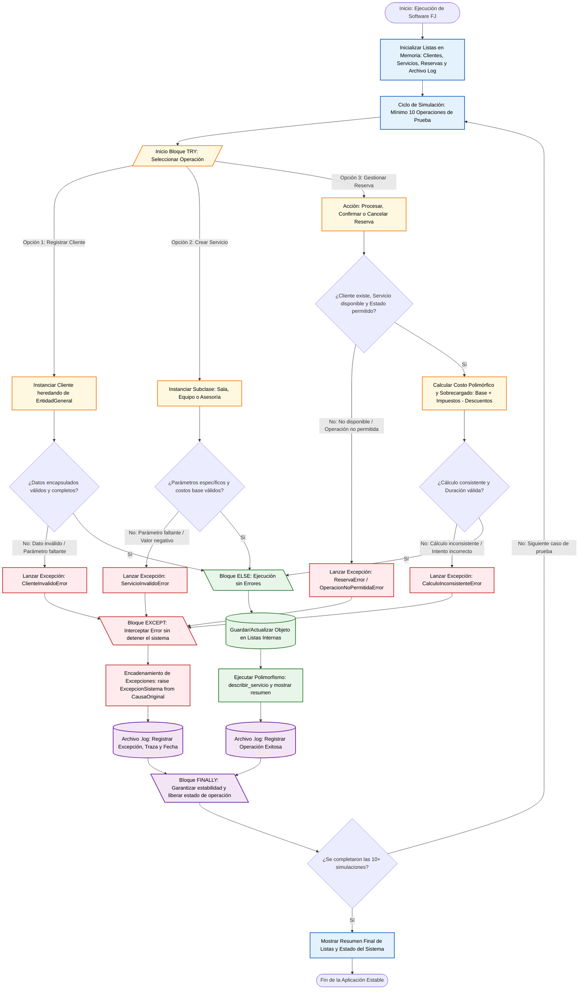

# Sistema Integral de Gestion de Clientes Servicios y Reservas (Software FJ)

## Planteamiento de la problematica a Resolver

La empresa Software FJ ha diversificado su portafolio comercial ofreciendo tres líneas de negocio principales: reserva de salas, alquiler de equipos y asesorías especializadas.

<u>El Problema</u>
Actualmente, la operación carece de un sistema centralizado y tolerante a fallos. Los errores humanos (datos incompletos, intentos de reservas sobre servicios no disponibles o cálculos inconsistentes) provocan caídas totales en la gestión operativa. Además, por restricciones de infraestructura y latencia, no es viable depender de un motor de bases de datos externo para este módulo, lo que exige una solución autónoma de alta velocidad.

<u>La Solución Requerida</u>
Se requiere desarrollar un Módulo Central de Gestión en Memoria (basado en una arquitectura robusta orientada a objetos) que administre todo el ciclo de vida operativo: clientes, catálogo de servicios y flujo de reservas.

### Tabla de Requerimentos

### Tabla de Requerimientos del Sistema - Software FJ

| ID | Categoría | Requerimiento | Detalle Técnico | Prioridad |
| :--- | :--- | :--- | :--- | :--- |
| **RF-01** | Arquitectura POO | Clase abstracta general | Representar entidades generales del sistema como base jerárquica. | Alta |
| **RF-02** | Gestión de Clientes | Clase Cliente | Encapsular datos personales con validaciones estrictas de entrada. | Alta |
| **RF-03** | Gestión de Servicios | Clase abstracta Servicio y derivadas | Crear clase base y mínimo 3 derivadas (salas, equipos, asesorías) con polimorfismo. | Alta |
| **RF-04** | Cálculos y Costos | Sobrescritura y sobrecarga | Sobrescribir cálculo de costos y sobrecargar métodos con impuestos o descuentos. | Alta |
| **RF-05** | Gestión de Reservas | Clase Reserva | Integrar cliente, servicio, duración y estado; incluir confirmación y cancelación. | Alta |
| **RNF-01** | Almacenamiento | Persistencia en memoria | Gestionar datos mediante listas internas y objetos, sin usar motores de bases de datos. | Alta |
| **RNF-02** | Estabilidad | Manejo avanzado de excepciones | Usar excepciones propias, bloques `try/except/else/finally` y encadenamiento. | Alta |
| **RNF-03** | Auditoría | Registro en archivo de Logs | Guardar errores y eventos relevantes en un archivo de texto manteniendo el sistema activo. | Alta |
| **RNF-04** | Pruebas | Simulación de operaciones | Ejecutar mínimo 10 operaciones combinando casos válidos, inválidos y fallidos. | Alta |

#### Notas adicionales de implementación:
* **Control de errores operativos (RNF-02):** El sistema debe interceptar datos inválidos, parámetros faltantes, operaciones no permitidas, servicios no disponibles y cálculos inconsistentes sin detener la ejecución general.
* **Entregable documental (RNF-05):** Presentar informe en PDF con portada, introducción, enlace al repositorio en GitHub, conclusiones y bibliografía en normas APA.

***

### Diagrama de Flujo

